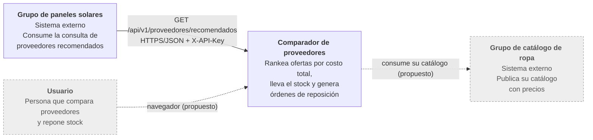
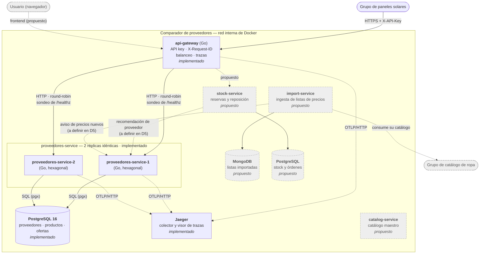
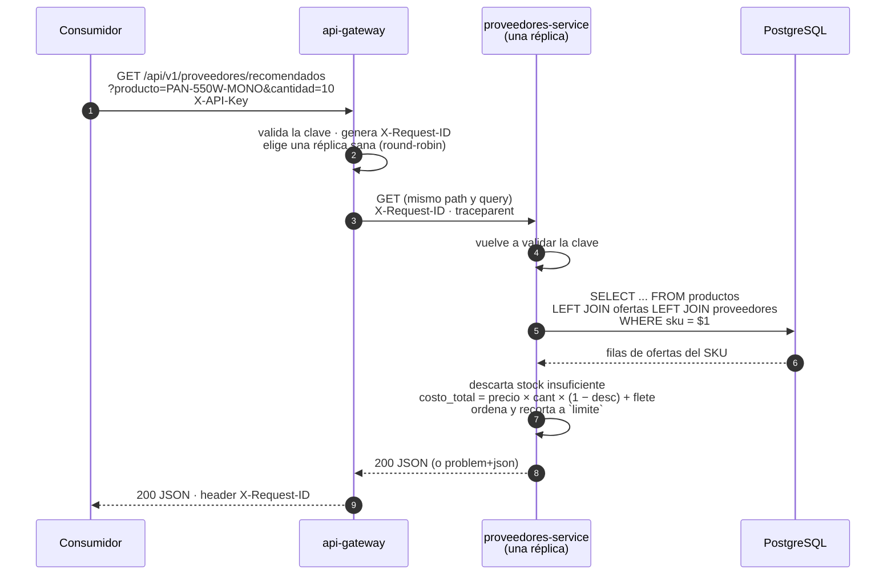

# Arquitectura

Comparador de proveedores con stock y reposición. Este documento explica cómo
está armado el sistema: qué servicios hay, qué hace cada uno, qué datos
administra, cómo se comunican y cómo se despliegan.

> **Qué está construido y qué no.** Cada elemento se marca como
> **implementado** (existe en el código de `main` y se levanta con
> `docker compose up`) o **propuesto** (diseñado, todavía sin código). Los
> diagramas usan línea punteada y fondo gris para lo propuesto. Mezclarlos sin
> marcarlos haría que este documento describa un sistema que no corre.

## 1. Resumen

| | |
|---|---|
| **Dominio** | Comparar proveedores por costo final (precio, descuento por volumen, flete y stock) y recomendar a quién comprar. |
| **Capacidad que publicamos** | `GET /api/v1/proveedores/recomendados`, consumida por el grupo de paneles solares. Contrato en [`docs/contracts/`](contracts/README.md). |
| **Capacidad que consumimos** | Catálogo de ropa de otro grupo, que entra como un proveedor más. *Propuesto: todavía no está integrado.* |
| **Lenguaje** | Go, solo biblioteca estándar más pocas dependencias (`pgx`, OpenTelemetry). |
| **Despliegue** | Docker Compose, un solo comando. Hoy corre solo en local. |

Estado a la fecha de la Entrega 2 (23/10/2026): **un servicio de dominio**
(`proveedores-service`, en dos réplicas), el `api-gateway`, PostgreSQL y Jaeger.

## 2. Contexto del sistema

Quién interactúa con el sistema desde afuera.

- **Hacia adentro** solo entra tráfico por el `api-gateway`.
- **Hacia afuera**, la llamada al grupo de ropa sale del servicio responsable de
  importar (consigna 4.1), no del gateway ni de un navegador.

## 3. Contenedores

Qué se despliega y cómo se conecta.

La línea punteada entre servicios de dominio indica una interacción **propuesta**:
su forma exacta (síncrona o por evento, timeouts, reintentos, idempotencia) la
fija la decisión D5 y todavía no está implementada.

## 4. Servicios y responsabilidades

Los criterios de corte están en [ADR-001](adr/ADR-001-limites-de-los-servicios.md).

| Servicio | Estado | Responsabilidad | Almacenamiento | Estilo interno |
|---|---|---|---|---|
| `api-gateway` | implementado | Entrada única: valida `X-API-Key`, genera o respeta `X-Request-ID`, abre el span padre de la traza, reparte la capacidad entre réplicas y las saca del reparto si caen. **Sin datos ni lógica de dominio.** | — | Proxy inverso con balanceador propio |
| `proveedores-service` | implementado | Calcula el costo total de cada oferta, descarta las que no tienen stock suficiente y devuelve las más baratas. Publica la capacidad compartida. | PostgreSQL | Hexagonal ([ADR-002](adr/ADR-002-arquitectura-interna.md)) |
| `stock-service` | propuesto | Stock propio, reserva sin sobreventa, punto de reorden y órdenes de reposición (`BORRADOR → SOLICITADA → CONFIRMADA`). | PostgreSQL | En capas (propuesto en ADR-002) |
| `import-service` | propuesto | Ingesta y normalización de listas de precios, incluido el catálogo de ropa. | MongoDB | a definir |
| `catalog-service` | propuesto | Catálogo maestro: mapeo de códigos de cada proveedor a un mismo producto. | a definir | a definir |

El código de cada servicio está en `services/<nombre>/`. El paquete compartido
`pkg/observabilidad` (logger JSON con `trace_id` e inicialización de
OpenTelemetry) lo usan el gateway y `proveedores-service`.

## 5. Propiedad de los datos

Cada dato tiene **un único dueño**. Ningún servicio lee la base de otro.

| Dato | Dueño | Dónde vive | Quién más lo ve |
|---|---|---|---|
| Proveedores (`proveedores`) | `proveedores-service` | PostgreSQL | Nadie directamente; se exponen por la API |
| Productos (`productos`) | `proveedores-service` (**provisorio**) | PostgreSQL | Ver la tensión en [ADR-001](adr/ADR-001-limites-de-los-servicios.md): pasa a `catalog-service` cuando exista |
| Ofertas (`ofertas`: precio, descuento, flete, stock del proveedor) | `proveedores-service` | PostgreSQL | Nadie directamente |
| Existencias propias y órdenes de reposición | `stock-service` (propuesto) | PostgreSQL | — |
| Listas de precios importadas | `import-service` (propuesto) | MongoDB | — |

Esquema implementado y motivos de la elección en
[ADR-003](adr/ADR-003-persistencia.md). **Distinción importante:** `stock_disponible`
en `ofertas` es el stock **del proveedor**, que el consumidor usa para saber si
puede comprarle; no es el stock propio, que será de `stock-service`.

## 6. Comunicaciones

| Origen → Destino | Tipo | Protocolo | Estado | Detalle |
|---|---|---|---|---|
| Consumidor externo → `api-gateway` | síncrona | HTTP/JSON, `X-API-Key` | implementado | Contrato en [`docs/contracts/`](contracts/README.md) |
| `api-gateway` → `proveedores-service` | síncrona | HTTP/JSON | implementado | Timeout de 3 s (`TIMEOUT_UPSTREAM`), un reintento en otra réplica si la conexión falla, solo para `GET` |
| `proveedores-service` → PostgreSQL | síncrona | SQL (pgx) | implementado | Timeout de 2 s por consulta |
| Servicios → Jaeger | asíncrona (telemetría) | OTLP/HTTP | implementado | Si Jaeger no está, el sistema responde igual |
| `stock-service` → `proveedores-service` | síncrona | HTTP | propuesto | Se define en D5 |
| `import-service` → `proveedores-service` | asíncrona (evento) | mensajería | propuesto | Se define en D5 |
| `import-service` → grupo de ropa | síncrona | HTTP | propuesto | Se define en D5 y D9 |

## 7. Flujo principal

La consulta de proveedores recomendados, de punta a punta. Es lo que se muestra
en la demo.

Variantes que el contrato documenta:

- **SKU inexistente:** el servicio devuelve `404 PRODUCTO_NO_ENCONTRADO` y el gateway lo
  pasa sin cambios.
- **Producto sin ofertas con stock suficiente:** `200` con `[]`.
- **Base caída:** `503 NO_DISPONIBLE` del servicio.
- **Réplica caída:** el gateway la marca, reintenta una vez en la otra y el cliente
  recibe `200`. Sin réplicas: `502 NO_DISPONIBLE`.
- **Réplica lenta:** `504 NO_DISPONIBLE` a los 3 s.

La traza de este flujo tiene cuatro spans (gateway servidor → gateway cliente →
servicio servidor → `SELECT`) y se explica en
[`docs/observabilidad/README.md`](observabilidad/README.md).

## 8. Despliegue

Un único procedimiento: copiar `.env.example` a `.env` y correr
`docker compose up -d --build`. Las migraciones y el seed los aplica el propio
servicio al arrancar, así que Postgres no necesita scripts de inicio.

| Contenedor | Imagen | Puerto al host | Salud |
|---|---|---|---|
| `api-gateway` | construida del repo (distroless) | `8080` (`PUERTO_GATEWAY`) | `/sonda` consulta `/readyz` |
| `proveedores-service-1` | construida del repo (distroless) | — | `/sonda` consulta `/readyz` (hace ping a la base) |
| `proveedores-service-2` | la misma imagen | — | ídem |
| `postgres` | `postgres:16-alpine` | — | `pg_isready` |
| `jaeger` | `jaegertracing/all-in-one:1.76.0` | `16686` (`PUERTO_JAEGER`, solo la UI) | `wget` al puerto de administración |

- **Red:** una red interna (`interna`). Al host solo salen el gateway y la UI
  de Jaeger; Postgres y las réplicas quedan inaccesibles desde afuera.
- **Volumen:** `datos-postgres` conserva la base entre reinicios.
- **Orden de arranque:** el gateway espera a que las dos réplicas estén sanas, y
  las réplicas esperan a Postgres. Jaeger **no** es una dependencia: sin él, todo
  responde igual.
- **Secretos:** ninguno en el repositorio. `.env` está en `.gitignore`; los
  valores de `.env.example` son solo para desarrollo local.
- **Dos réplicas con nombre** y no `deploy.replicas`: el gateway necesita dos
  nombres DNS distintos para repartir de verdad
  ([ADR-012](adr/ADR-012-balanceo-de-carga.md)).

## 9. Observabilidad

Logs JSON (`log/slog`) correlacionados con `request_id` y `trace_id`, y trazas
OpenTelemetry hasta la consulta a PostgreSQL. No hay métricas ni tablero todavía.
Detalle y límites en [ADR-011](adr/ADR-011-observabilidad.md).

## 10. Decisiones arquitectónicas

| # | Decisión | Documento | Estado |
|---|---|---|---|
| D1 | Límites de los servicios | [ADR-001](adr/ADR-001-limites-de-los-servicios.md) | aceptado (2 servicios); 3 propuestos |
| D2 | Arquitectura interna | [ADR-002](adr/ADR-002-arquitectura-interna.md) | aceptado |
| D3 | Persistencia | [ADR-003](adr/ADR-003-persistencia.md) | aceptado (PostgreSQL); resto propuesto |
| D8 | Contrato propio | [ADR-008](adr/ADR-008-contrato-propio.md) | aceptado |
| D11 | Observabilidad | [ADR-011](adr/ADR-011-observabilidad.md) | aceptado para logs y trazas; resto propuesto |
| D12 | Balanceo de carga | [ADR-012](adr/ADR-012-balanceo-de-carga.md) | aceptado |

Las demás decisiones obligatorias (D4, D5, D6, D7, D9, D10, D13) todavía no tienen
documento publicado en esta rama.

## 11. Limitaciones conocidas y deuda técnica

Lo que **no** hace el sistema hoy, dicho sin maquillaje. Es lo que la presentación
grupal pide actualizar.

**Alcance que falta (consigna)**

- **Un solo servicio de dominio.** La consigna pide al menos tres más el gateway
  para la presentación. `stock-service`, `import-service` y `catalog-service` son
  solo diseño.
- **Un solo tipo de almacenamiento.** Falta el no relacional (MongoDB) para cumplir
  con los dos tipos.
- **Sin frontend.** No hay interfaz web.
- **Sin comunicación asíncrona.** No hay mensajería, evento de dominio ni
  consumidor idempotente.
- **Sin motor de búsqueda ni caché.** Hoy cada consulta va a PostgreSQL.
- **Sin integración real con el grupo de ropa.** El catálogo de ropa todavía no
  entra al flujo, así que hoy no cuenta como integración con consecuencias sobre
  el negocio (consigna 4.1).
- **Sin despliegue en la nube.** La capacidad corre solo en local; falta la URL
  pública que pide la presentación.

**Calidad y operación**

- **Sin métricas, tablero ni alertas.** Solo hay logs y trazas.
- **Sin control de tráfico.** El gateway valida la clave pero no limita requests.
- **Sin pipeline de CI** que corra los tests en cada push.
- **PostgreSQL es un punto único de falla.** El balanceo cubre al servicio, no a
  la base.
- **Jaeger guarda las trazas en memoria y se exporta el 100 %**, sin muestreo:
  alcanza para la demo, no para carga real.
- **El gateway traza sus propias rutas de salud** y llena Jaeger de sondeos.
- **Los sondeos de salud dominan los logs** de las réplicas.
- **La detección de una réplica caída sin tráfico tarda hasta un intervalo de
  sondeo** (5 s).
- **Las claves de API son una lista en una variable de entorno:** sin rotación
  automática ni identidad por consumidor.

**Modelo y datos**

- **`productos` está provisoriamente en `proveedores-service`**, pero su dueño
  natural será `catalog-service` ([ADR-001](adr/ADR-001-limites-de-los-servicios.md)).
- **Importes en `float64`** con redondeo final a 2 decimales, y sin moneda en el
  contrato.
- **El ranking filtra y ordena en memoria** las ofertas del SKU: aceptable con
  decenas, no con miles ([ADR-002](adr/ADR-002-arquitectura-interna.md)).
- **No hay escrituras en el flujo actual:** los precios y el stock del proveedor
  solo cambian por el seed.
- **La decisión de consistencia y concurrencia (D4) no está escrita todavía.**

## 12. Cómo se mantiene este documento

Se actualiza junto con el código. Cuando un elemento pasa de *propuesto* a
*implementado*, se cambia la marca, el color del diagrama y la fila de la tabla en
la misma rama que el código. Una diferencia entre este documento y el código es
un error de documentación y se corrige.
