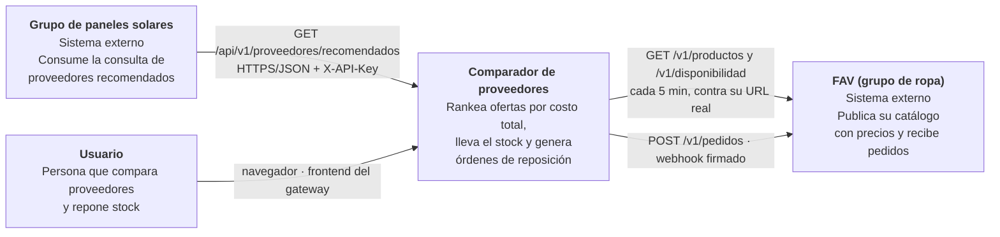
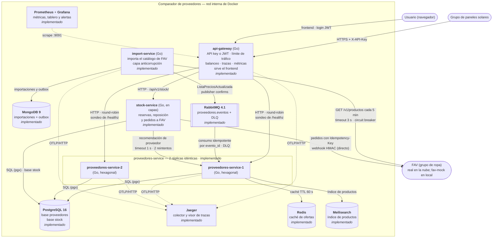
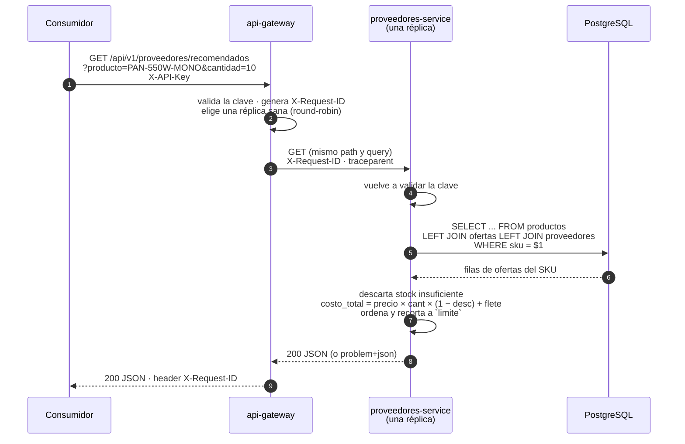

# Arquitectura

Comparador de proveedores con stock y reposición. Este documento explica cómo
está armado el sistema: qué servicios hay, qué hace cada uno, qué datos
administra, cómo se comunican y cómo se despliegan.

> **Qué está construido y qué no.** Cada elemento se marca como
> **implementado** (existe en el código de `main` y se levanta con
> `docker compose up`) o **propuesto** (diseñado, todavía sin código).
> Mezclarlos sin marcarlos haría que este documento describa un sistema que no
> corre.
>
> **Al 11/11 todo lo que aparece en los diagramas está implementado.** Lo único
> propuesto es `catalog-service`, que quedó fuera de alcance
> ([ADR-014](adr/ADR-014-tres-servicios-sin-catalogo.md)) y por eso ya no
> aparece.

## 1. Resumen

| | |
|---|---|
| **Dominio** | Comparar proveedores por costo final (precio, descuento por volumen, flete y stock) y recomendar a quién comprar. |
| **Capacidad que publicamos** | `GET /api/v1/proveedores/recomendados`, consumida por el grupo de paneles solares. Contrato en [`docs/contracts/`](contracts/README.md). |
| **Capacidad que consumimos** | Catálogo y pedidos de FAV (grupo de ropa), que entra como un proveedor más. *El catálogo se importa **del FAV real desplegado** desde el 11/11, con el stock que informa su `GET /v1/disponibilidad`. Los pedidos están implementados, pero su contrato 1.2.0 quitó la consulta de estado y el webhook, así que una orden enviada no se cierra sola ([ADR-009](adr/ADR-009-consumo-proveedor.md)).* |
| **Lenguaje** | Go, solo biblioteca estándar más pocas dependencias (`pgx`, OpenTelemetry, el driver de MongoDB y el cliente de RabbitMQ). |
| **Despliegue** | Docker Compose, un solo comando. En la nube: **<http://20.226.84.78/>** ([`NUBE.md`](NUBE.md)). |

Estado al 11/11/2026: **tres servicios de dominio** (`proveedores-service`, en
dos réplicas, `import-service` y `stock-service`), el `api-gateway` con el
frontend embebido, dos bases PostgreSQL, MongoDB, RabbitMQ, Redis, Meilisearch,
Prometheus, Grafana y Jaeger. **Los 14 contenedores corren, en local y en la
nube.** Lo único que queda fuera del alcance es `catalog-service`
([ADR-014](adr/ADR-014-tres-servicios-sin-catalogo.md)).

## 2. Contexto del sistema

Quién interactúa con el sistema desde afuera.

- **Hacia adentro** solo entra tráfico por el `api-gateway`.
- **Hacia afuera**, las llamadas al grupo de ropa (FAV) salen del servicio
  responsable (consigna 4.1): el catálogo, de `import-service`, y los pedidos de
  reposición, de `stock-service`; nunca del gateway ni de un navegador. El único
  tráfico de FAV hacia nosotros es su webhook firmado, que recibe `stock-service`
  directamente y no el gateway, porque la consigna (4.1) prohíbe canalizar la
  comunicación con el proveedor por el punto de entrada propio
  ([ADR-009](adr/ADR-009-consumo-proveedor.md)).

## 3. Contenedores

Qué se despliega y cómo se conecta.

Las líneas punteadas son telemetría (trazas y métricas): si el colector no está, el sistema responde igual. La forma de cada interacción
(síncrona o por evento, timeouts, reintentos, idempotencia) está en
[ADR-005](adr/ADR-005-comunicacion.md); el evento entre `import-service` y
`proveedores-service`, en [`contracts/eventos.md`](contracts/eventos.md).
`catalog-service` ya no está: su trabajo lo hace la capa anticorrupción de
`import-service` ([ADR-014](adr/ADR-014-tres-servicios-sin-catalogo.md)).

## 4. Servicios y responsabilidades

Los criterios de corte están en [ADR-001](adr/ADR-001-limites-de-los-servicios.md).

| Servicio | Estado | Responsabilidad | Almacenamiento | Estilo interno |
|---|---|---|---|---|
| `api-gateway` | implementado | Entrada única: autentica con `X-API-Key` o con el JWT del login, limita el tráfico por identidad (token bucket, `429`), genera o respeta `X-Request-ID`, abre el span padre de la traza, reparte la capacidad entre réplicas y las saca del reparto si caen, publica `stock-service` en `/api/v1/stock/`, expone métricas y sirve el frontend. **Sin datos ni lógica de dominio.** | — | Proxy inverso con balanceador propio |
| `proveedores-service` | implementado | Calcula el costo total de cada oferta, descarta las que no tienen stock suficiente y devuelve las más baratas. Publica la capacidad compartida. | PostgreSQL | Hexagonal ([ADR-002](adr/ADR-002-arquitectura-interna.md)) |
| `stock-service` | implementado | Stock propio, reserva sin sobreventa, punto de reorden, órdenes de reposición (`BORRADOR → SOLICITADA → CONFIRMADA`), pedidos a FAV y su webhook. Publicado por el gateway en `/api/v1/stock/` (el webhook no). | PostgreSQL (base `stock`, con su propio usuario) | En capas: `handler → service → repository` ([ADR-002](adr/ADR-002-arquitectura-interna.md)) |
| `import-service` | implementado | Baja el catálogo de FAV cada 5 min, lo traduce a ofertas (capa anticorrupción), lo compara con lo último avisado y publica `ListaPreciosActualizada`. Sin tráfico de afuera: solo `/healthz`, `/readyz`, `/estado` y `POST /sincronizar` en la red interna. | MongoDB | Puertos y adaptadores livianos: `dominio` y `sincronizacion` no conocen MongoDB, RabbitMQ ni HTTP |
| `fav-mock` | implementado (solo local) | Hacía de FAV mientras no tuviéramos su URL. Desde el 11/11 el catálogo sale del FAV real y el mock queda para desarrollo sin internet, para los tests de contrato y para **simular fallas en el Game Day**, que contra el FAV real no se puede. No es parte del sistema. | — | — |

El código de cada servicio está en `services/<nombre>/`. Hay dos paquetes
compartidos: `pkg/observabilidad` (logger JSON con `trace_id` e inicialización
de OpenTelemetry), que usan todos los servicios, y `pkg/mensajeria` (sobre de los
eventos, topología de RabbitMQ y publicador), que usan quien publica y quien
consume.

## 5. Propiedad de los datos

Cada dato tiene **un único dueño**. Ningún servicio lee la base de otro.

| Dato | Dueño | Dónde vive | Quién más lo ve |
|---|---|---|---|
| Proveedores (`proveedores`) | `proveedores-service` | PostgreSQL | Nadie directamente; se exponen por la API |
| Productos (`productos`) | `proveedores-service` | PostgreSQL | Los de proveedores externos llegan por el evento `ListaPreciosActualizada` ([ADR-014](adr/ADR-014-tres-servicios-sin-catalogo.md)) |
| Ofertas (`ofertas`: precio, descuento, flete, stock del proveedor) | `proveedores-service` | PostgreSQL | Nadie directamente |
| Existencias propias, reservas, órdenes de reposición y avisos de FAV recibidos | `stock-service` | PostgreSQL (base `stock`) | — |
| Importaciones: respuesta cruda del proveedor, catálogo traducido vigente y eventos a publicar | `import-service` | MongoDB | Nadie directamente; los cambios salen por el evento |

Esquema implementado y motivos de la elección en
[ADR-003](adr/ADR-003-persistencia.md). **Distinción importante:** `stock_disponible`
en `ofertas` es el stock **del proveedor**, que el consumidor usa para saber si
puede comprarle; no es el stock propio, que es de `stock-service`.

## 6. Comunicaciones

| Origen → Destino | Tipo | Protocolo | Estado | Detalle |
|---|---|---|---|---|
| Consumidor externo → `api-gateway` | síncrona | HTTP/JSON, `X-API-Key` | implementado | Contrato en [`docs/contracts/`](contracts/README.md) |
| `api-gateway` → `proveedores-service` | síncrona | HTTP/JSON | implementado | Timeout de 3 s (`TIMEOUT_UPSTREAM`), un reintento en otra réplica si la conexión falla, solo para `GET` |
| `proveedores-service` → PostgreSQL | síncrona | SQL (pgx) | implementado | Timeout de 2 s por consulta |
| Servicios → Jaeger | asíncrona (telemetría) | OTLP/HTTP | implementado | Si Jaeger no está, el sistema responde igual |
| `stock-service` → `proveedores-service` | síncrona | HTTP, directo a una réplica | implementado | Timeout de 1 s y 2 reintentos ([ADR-005](adr/ADR-005-comunicacion.md)) |
| `import-service` → RabbitMQ → `proveedores-service` | asíncrona (evento `ListaPreciosActualizada`) | AMQP 0-9-1 | implementado de punta a punta | Outbox en MongoDB, *publisher confirms*, DLQ tras 3 entregas ([`eventos.md`](contracts/eventos.md)) |
| `import-service` → MongoDB | síncrona | MongoDB wire | implementado | Timeout de 3 s por operación |
| `import-service` → FAV (grupo de ropa), catálogo y disponibilidad | síncrona | HTTPS, cada 5 min | implementado **contra el FAV real** (11/11) | [ADR-009](adr/ADR-009-consumo-proveedor.md): timeout de 3 s, 3 reintentos, circuit breaker, última importación válida hasta 24 h |
| `stock-service` → FAV, pedidos | síncrona | HTTP con `Idempotency-Key` | implementado, probado contra `fav-mock` | [ADR-009](adr/ADR-009-consumo-proveedor.md): timeout de 3 s, 3 reintentos con la misma clave, consulta de respaldo cada 15 min |
| FAV → `stock-service` (directo, sin gateway) | asíncrona (webhook) | HTTP firmado con HMAC | implementado, pero **sin uso**: FAV no tiene webhook desde su 1.2.0 y la 1.3.0 no lo repuso | Aviso de cambio de estado del pedido: firma, deduplicación por `eventoId` y confirmación con `GET` ([ADR-009](adr/ADR-009-consumo-proveedor.md)) |

## 7. Flujo principal

La consulta de proveedores recomendados, de punta a punta. Es lo que se muestra
en la demo.

Variantes que el contrato documenta:

- **SKU inexistente:** el servicio devuelve `404 PRODUCTO_NO_ENCONTRADO` y el gateway lo
  pasa sin cambios.
- **Producto sin ofertas con stock suficiente:** `200` con `[]`.
- **Base caída:** `503 NO_DISPONIBLE` del servicio.
- **Réplica caída:** el gateway la marca, reintenta una vez en la otra y el cliente
  recibe `200`. Sin réplicas: `502 NO_DISPONIBLE`.
- **Réplica lenta:** `504 NO_DISPONIBLE` a los 3 s.

La traza de este flujo tiene cuatro spans (gateway servidor → gateway cliente →
servicio servidor → `SELECT`) y se explica en
[`docs/observabilidad/README.md`](observabilidad/README.md).

## 8. Despliegue

Un único procedimiento: copiar `.env.example` a `.env` y correr
`docker compose up -d --build`. Las migraciones y el seed los aplica cada
servicio al arrancar. Postgres corre un solo script de inicio, al crear el
volumen, que arma la base de `stock-service` con su propio usuario
(`infra/postgres/init/`).

| Contenedor | Imagen | Puerto al host | Salud |
|---|---|---|---|
| `api-gateway` | construida del repo (distroless) | `8080` (`PUERTO_GATEWAY`) | `/sonda` consulta `/readyz` |
| `proveedores-service-1` | construida del repo (distroless) | — | `/sonda` consulta `/readyz` (hace ping a la base) |
| `proveedores-service-2` | la misma imagen | — | ídem |
| `postgres` | `postgres:16-alpine` | — | `pg_isready` |
| `jaeger` | `jaegertracing/all-in-one:1.76.0` | `16686` (`PUERTO_JAEGER`, solo la UI) | `wget` al puerto de administración |
| `import-service` | construida del repo (distroless) | — | `/sonda` consulta `/readyz` (hace ping a MongoDB) |
| `fav-mock` | la imagen de `import-service`, otro entrypoint | `8090` (`PUERTO_FAV_MOCK`, para simular fallas) | `/sonda` |
| `rabbitmq` | `rabbitmq:4.1-management-alpine` | `15672` (`PUERTO_RABBITMQ_UI`, solo la UI) | `rabbitmq-diagnostics ping` |
| `mongodb` | `mongo:8.0` | — | `mongosh` con `ping` |
| `redis` | `redis:7.4-alpine`, sin persistencia | — | `redis-cli ping` |
| `meilisearch` | `getmeili/meilisearch:v1.14` | — | `curl` a `/health` |
| `stock-service` | construida del repo (distroless) | — | `/sonda` consulta `/readyz` |
| `prometheus` | `prom/prometheus:v3.5.0` | `9090` (`PUERTO_PROMETHEUS`) | `wget` a `/-/ready` |
| `grafana` | `grafana/grafana:12.1.1` | `3000` (`PUERTO_GRAFANA`) | — |

- **Red:** una red interna (`interna`). Al host salen el gateway (la única
  entrada al sistema, que además sirve el frontend) y las consolas de
  operación: Jaeger, RabbitMQ, Prometheus, Grafana y el control del mock de
  FAV, que hace de sistema externo. El puerto de métricas del gateway (9091) no
  se publica. Las bases,
  el broker y los servicios quedan inaccesibles desde afuera.
- **Volúmenes:** `datos-postgres`, `datos-mongodb`, `datos-rabbitmq`,
  `datos-meilisearch`, `datos-prometheus` y `datos-grafana`. Redis no tiene: es caché y se vuelve a llenar.
- **Orden de arranque:** el gateway espera a que las dos réplicas estén sanas,
  las réplicas esperan a Postgres e `import-service` espera a MongoDB. Jaeger,
  RabbitMQ y FAV **no** son dependencias duras: sin ellos todo arranca y responde
  (los eventos esperan en el outbox, siguen las últimas ofertas de FAV).
- **Secretos:** ninguno en el repositorio. `.env` está en `.gitignore`; los
  valores de `.env.example` son solo para desarrollo local.
- **Dos réplicas con nombre** y no `deploy.replicas`: el gateway necesita dos
  nombres DNS distintos para repartir de verdad
  ([ADR-012](adr/ADR-012-balanceo-de-carga.md)).
- **Nube:** una VM con el mismo compose más `docker-compose.nube.yml`, que deja
  solo el gateway hacia afuera (puerto 80) y ata las consolas a `127.0.0.1`
  (opción A de [ADR-013](adr/ADR-013-capacidad-y-costos.md)). Paso a paso en
  [`NUBE.md`](NUBE.md).
- **CI:** GitHub Actions (`.github/workflows/ci.yml`) corre `go vet` y los tests
  unitarios de los seis módulos en cada push, después los de integración con
  testcontainers y el build de las imágenes.

## 9. Observabilidad

Logs JSON (`log/slog`) correlacionados con `request_id` y `trace_id`, y trazas
OpenTelemetry hasta la consulta a PostgreSQL. `import-service` usa el mismo
paquete: cada sincronización es un span con la llamada a FAV adentro, sus logs
llevan `trace_id` y el evento sale con `traceparent` para que el consumidor
continúe la traza. El gateway expone métricas Prometheus (tasa, errores y
latencia por ruta, rechazos por límite, réplicas sanas); Prometheus evalúa
tres alertas (p95 > 300 ms, 5xx > 1 %, sin réplicas sanas) y Grafana carga
solo el tablero de la capacidad (`infra/`).
Detalle y límites en [ADR-011](adr/ADR-011-observabilidad.md).

## 10. Decisiones arquitectónicas

| # | Decisión | Documento | Estado |
|---|---|---|---|
| D1 | Límites de los servicios | [ADR-001](adr/ADR-001-limites-de-los-servicios.md) y [ADR-014](adr/ADR-014-tres-servicios-sin-catalogo.md) | aceptado para los cuatro servicios, los cuatro implementados; sin `catalog-service` (ADR-014, **propuesto**: espera la confirmación de la cátedra) |
| D2 | Arquitectura interna | [ADR-002](adr/ADR-002-arquitectura-interna.md) | aceptado e implementado: hexagonal en proveedores y en capas en stock |
| D3 | Persistencia | [ADR-003](adr/ADR-003-persistencia.md) | aceptado e implementado: PostgreSQL en proveedores y stock (una base por servicio), MongoDB en import |
| D4 | Consistencia y concurrencia | [ADR-004](adr/ADR-004-consistencia-y-concurrencia.md) | aceptado e implementado: reserva con `FOR UPDATE` e idempotencia, con el test de 20 reservas simultáneas en verde contra PostgreSQL real |
| D5 | Comunicación entre servicios | [ADR-005](adr/ADR-005-comunicacion.md) | aceptado e implementado: síncrono, y el evento de punta a punta (publicación con outbox y consumo idempotente), verificado con el broker caído |
| D6 | Búsqueda | [ADR-006](adr/ADR-006-busqueda.md) | aceptado e implementado: Meilisearch con paginación, filtros, orden y reconstrucción, con el retraso del índice medido |
| D7 | Caché | [ADR-007](adr/ADR-007-cache.md) | aceptado e implementado: Redis como decorador, con la comparación antes y después medida (6,5 ms contra 56,6 ms sin caché) |
| D8 | Contrato propio | [ADR-008](adr/ADR-008-contrato-propio.md) | aceptado: contrato 1.1.0, con el `429` del límite de tráfico |
| D9 | Consumo del proveedor | [ADR-009](adr/ADR-009-consumo-proveedor.md) | aceptado: catálogo y pedidos con webhook, con test de contrato |
| D10 | Resiliencia | [ADR-010](adr/ADR-010-resiliencia.md) | aceptado e implementado, con el Game Day de siete caídas medido ([`POSTMORTEM.md`](POSTMORTEM.md)); la caché como respaldo y el breaker en los pedidos siguen propuestos |
| D11 | Observabilidad | [ADR-011](adr/ADR-011-observabilidad.md) | aceptado e implementado: logs, trazas, métricas, tablero, objetivo de servicio y alertas |
| D12 | Balanceo de carga | [ADR-012](adr/ADR-012-balanceo-de-carga.md) | aceptado e implementado: 20 de 20 requests en `200` con una réplica caída |
| D13 | Capacidad y costos | [ADR-013](adr/ADR-013-capacidad-y-costos.md) | aceptado e implementado: test de carga (1 200 req/s sostenidas) y la opción A desplegada en <http://20.226.84.78/> |

**Bonus:** el grupo no toma ninguno (anunciado en la Entrega 2, consigna sección 7).

La plantilla para los ADR nuevos está en [`adr/TEMPLATE.md`](adr/TEMPLATE.md).

## 11. Limitaciones conocidas y deuda técnica

Lo que **no** hace el sistema hoy, dicho sin maquillaje. Es lo que la presentación
grupal pide actualizar.

**Alcance que falta (consigna)**

- **Tres servicios de dominio, sin `catalog-service`.** `proveedores-service`,
  `import-service` y `stock-service` están implementados; `catalog-service` sale
  del alcance ([ADR-014](adr/ADR-014-tres-servicios-sin-catalogo.md), a validar).
- **Frontend mínimo.** Login → buscar por texto → ranking → stock propio →
  reservar. Alcanza para mostrar el flujo completo; no tiene manejo de sesión más
  allá del JWT en memoria, ni vistas de administración (órdenes de reposición,
  estado de la importación), que se operan por API.
- **Un pago de FAV se sabe con retraso, no al instante.** El catálogo y la
  consulta de estado del pedido salen del FAV real; lo que **no existe de su
  lado es el webhook**, que quitó en su 1.2.0 y no repuso en la 1.3.0. Entonces
  una orden pasa a `CONFIRMADA` en la vuelta siguiente de la consulta periódica
  (cada 15 min) y no cuando FAV acredita el pago. Nuestro receptor del webhook
  existe y está probado, pero no tiene quién lo llame
  ([ADR-009](adr/ADR-009-consumo-proveedor.md)).
- **Los pedidos a FAV no tienen circuit breaker** (el catálogo sí): tienen timeout,
  reintentos y la vuelta cada 15 minutos, que ya acota la carga sobre FAV caído.
- **Quedan en el índice de búsqueda las ofertas dadas de baja, con stock 0**, en
  lugar de desaparecer. No afectan el ranking —con 0 no se recomienda— pero se ven
  al buscar. Son las 7 variantes que tenía el mock y el FAV real no tiene.
- **La caché no tiene circuit breaker.** Con Redis caído cada lectura paga los
  50 ms completos del timeout del decorador antes de ir a PostgreSQL: medido en el
  Game Day, la latencia pasa de 6,5 ms a 56,6 ms sin dejar de responder correcto
  ([`POSTMORTEM.md`](POSTMORTEM.md#escenario-1--redis-caído)). La pieza ya existe
  en `import-service/internal/resiliencia`, pero vive en el `internal` de otro
  módulo y hoy no se puede reutilizar.
- **La nube no tiene HTTPS.** El sistema completo está desplegado en
  <http://20.226.84.78/> (VM de Azure, 2 vCPU y 8 GB, [`NUBE.md`](NUBE.md)),
  pero la URL es `http://`: para TLS hace falta un dominio y un proxy con
  certificado automático. No lo pide la consigna.
- **Una sola VM, sin réplicas ni respaldo.** Si se cae la máquina, se cae todo:
  el balanceo cubre al servicio, no al host. Es la opción A de
  [ADR-013](adr/ADR-013-capacidad-y-costos.md), elegida a propósito por costo.
- **El test de carga no se repitió contra la nube.** Con 2 vCPU mediría la VM y
  no la arquitectura; las mediciones publicadas son locales.

**Calidad y operación**

- **Las alertas no notifican.** Prometheus las evalúa y se ven en su UI y en el
  tablero, pero no hay Alertmanager que mande un mail o un mensaje.
- **Las métricas son solo del gateway.** Alcanzan para la capacidad tal como la
  ve el cliente; los servicios no exponen las suyas (pool de conexiones, ciclo
  de reposición, sincronización con FAV).
- **El límite de tráfico vive en la memoria del gateway.** Con una sola
  instancia alcanza; con varias, cada una tendría su propio balde.
- **Usuarios del frontend en una variable de entorno** (`USUARIOS`), con la
  contraseña en claro en el `.env` y sin roles. Es de demo: un sistema real
  tendría una tabla de usuarios con hashes (bcrypt/argon2) o un proveedor de
  identidad. El JWT no se puede revocar antes de que venza (1 h).
- **El gateway es el cuello de botella y puede colapsar bajo sobrecarga.** Es el
  componente que más CPU gasta (40 % del total por request). El transporte con pool
  propio ya está aplicado —bajó su CPU un 31 % respecto del transporte por defecto
  de Go, que reutilizaba solo 2 conexiones por réplica—. La capacidad declarada es de
  1 200 req/s; desde ~1 600 req/s el resultado varía entre corridas, y una rampa
  colapsó en ese escalón con `504` ([ADR-013](adr/ADR-013-capacidad-y-costos.md)).
- **PostgreSQL es un punto único de falla.** El balanceo cubre al servicio, no a
  la base. Con la base caída el sistema responde `503 NO_DISPONIBLE` a los 2 s, sin
  colgarse, contra un timeout de 3 s en el gateway: el margen es de 1 segundo
  ([ADR-010](adr/ADR-010-resiliencia.md)).
- **El único puerto que sale a internet es el 80, del gateway.** El 8081 del webhook
  de FAV se abrió el 10/11 y se cerró el 11/11, cuando su 1.2.0 mostró que no hay
  webhook: un puerto abierto sin consumidor dejaba `/api/v1/stock/...` accesible por
  fuera del gateway —detrás de su clave, pero **sin el límite de tráfico**— a cambio
  de nada. Si FAV lo publica, lo correcto no es reabrir el puerto del servicio sino
  un proxy que exponga **solo** la ruta del webhook.
- **El `/readyz` del gateway sigue en `200` con PostgreSQL caído.** Es coherente
  —el gateway no tiene base y su trabajo es rutear— pero significa que un
  orquestador no lo sacaría de rotación aunque no pueda servir nada útil. Hoy lo
  cubre la alerta por tasa de errores. Verificado en el Game Day.
- **Jaeger guarda las trazas en memoria, sin tope, y se exporta el 100 %**, sin
  muestreo: alcanza para la demo, no para carga real. Llegó a 1,6 GB en una rampa
  de 4 minutos del test de carga ([ADR-013](adr/ADR-013-capacidad-y-costos.md)).
- **El gateway traza sus propias rutas de salud** y llena Jaeger de sondeos.
- **Los sondeos de salud dominan los logs** de las réplicas.
- **La detección de una réplica caída sin tráfico tarda hasta un intervalo de
  sondeo** (5 s).
- **Las claves de API son una lista en una variable de entorno:** sin rotación
  automática ni identidad por consumidor.

**Modelo y datos**

- **`productos` vive en `proveedores-service`** aunque lo alimenta la importación.
  Con `catalog-service` fuera de alcance ([ADR-014](adr/ADR-014-tres-servicios-sin-catalogo.md))
  ya no hay un dueño "natural" esperando: queda como está y se asume la tensión.
- **Importes en `float64`** con redondeo final a 2 decimales, y sin moneda en el
  contrato.
- **El ranking filtra y ordena en memoria** las ofertas del SKU: aceptable con
  decenas, no con miles ([ADR-002](adr/ADR-002-arquitectura-interna.md)).
- **Las ofertas de los proveedores propios solo cambian por el seed.** Las de FAV
  sí se actualizan solas, por el evento de la importación; no hay un alta ni una
  edición de ofertas por API para los demás proveedores.

## 12. Cómo se mantiene este documento

Se actualiza junto con el código. Cuando un elemento pasa de *propuesto* a
*implementado*, se cambia la marca, el color del diagrama y la fila de la tabla en
la misma rama que el código. Una diferencia entre este documento y el código es
un error de documentación y se corrige.
