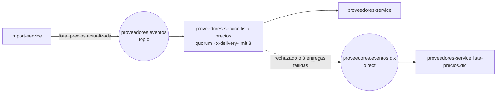

# Eventos de dominio (mensajería interna)

Contrato de los eventos que viajan por RabbitMQ entre nuestros servicios. A
diferencia de [`openapi.yaml`](openapi.yaml), **no es una capacidad para otros
grupos**: es el acuerdo entre quien publica y quien consume dentro del sistema.
La decisión está en [ADR-005](../adr/ADR-005-comunicacion.md).

El código que lo implementa está en [`pkg/mensajeria`](../../pkg/mensajeria/):
los tipos de Go, la topología y el publicador. **Quien consume usa ese mismo
paquete**: así las colas se declaran con los mismos argumentos de los dos lados.

| Evento | Publica | Consume | Estado |
|---|---|---|---|
| [`ListaPreciosActualizada`](#listapreciosactualizada-v1) v1 | `import-service` | `proveedores-service` | publicación implementada; consumo pendiente (Integrante 2) |
| `StockBajoMinimo` | `stock-service` | `stock-service` (worker) | propuesto (Integrante 3) |

## Sobre común

Todo evento va dentro del mismo sobre JSON:

| Campo | Tipo | Para qué |
|---|---|---|
| `evento_id` | UUID v4 (texto) | **Deduplicar.** La entrega es *al menos una vez*: el mismo evento puede llegar dos veces. |
| `tipo` | texto | Nombre del evento, por ejemplo `ListaPreciosActualizada`. |
| `version` | entero ≥ 1 | Versión del formato de `datos`. Un cambio incompatible sube la versión. |
| `ocurrido_en` | fecha RFC 3339 en UTC | Cuándo pasó. |
| `traceparent` | texto W3C (opcional) | Para que el consumidor continúe la misma traza en Jaeger. |
| `datos` | objeto | Lo propio de cada evento. |

Propiedades del mensaje AMQP: `content_type: application/json`, `delivery_mode: 2`
(persistente), `message_id` = `evento_id` y `type` = `tipo`.

## Topología



| Elemento | Nombre | Configuración |
|---|---|---|
| Exchange de eventos | `proveedores.eventos` | `topic`, durable |
| Clave de ruteo | `lista_precios.actualizada` | |
| Cola del consumidor | `proveedores-service.lista-precios` | quorum, durable; `x-delivery-limit: 3`; `x-dead-letter-exchange: proveedores.eventos.dlx`; `x-dead-letter-routing-key: proveedores-service.lista-precios.dlq` |
| Exchange de fallidos | `proveedores.eventos.dlx` | `direct`, durable |
| Cola de fallidos (DLQ) | `proveedores-service.lista-precios.dlq` | quorum, durable |

Los dos lados llaman a `mensajeria.DeclararTopologia` al conectarse. El que
publica también la declara para que **ningún evento se pierda si el consumidor
todavía no arrancó**: el mensaje espera en la cola.

## `ListaPreciosActualizada` v1

Lo publica `import-service` cuando cambian las ofertas de un proveedor externo
(hoy, FAV). Trae **solo lo que cambió** respecto del evento anterior del mismo
proveedor, salvo cuando `completa` es `true`.

| Campo de `datos` | Tipo | Qué es |
|---|---|---|
| `proveedor` | `{id, codigo, nombre}` | El proveedor dueño de las ofertas. FAV es el `id` 11 (lo crea la migración `003_proveedor_fav.sql` de `proveedores-service`). |
| `importacion_id` | texto | Id de la importación en MongoDB, para rastrear de dónde salió. |
| `secuencia` | entero | Crece con cada evento del mismo proveedor (1, 2, 3…). |
| `motivo` | `sincronizacion` o `catalogo_vencido` | `catalogo_vencido`: el proveedor lleva más de 24 h sin poder sincronizarse y se retiran todas sus ofertas ([ADR-009](../adr/ADR-009-consumo-proveedor.md)). |
| `completa` | booleano | `true`: `ofertas` es el catálogo entero de ese proveedor y hay que borrar las suyas que no vengan en la lista. Pasa en la primera sincronización y después de un vencimiento. |
| `productos` | lista | Productos nuevos o con nombre, categoría o unidad cambiados. Mismas columnas que la tabla `productos`. |
| `ofertas` | lista | Ofertas nuevas o modificadas (o todas, si `completa`). Mismas columnas que la tabla `ofertas`, sin `proveedor_id`, que va en `proveedor.id`. |
| `bajas` | lista de SKU | Ofertas de este proveedor que hay que borrar. Nunca es `null`: si no hay, va `[]`. |

Ejemplo (segunda sincronización: cambió un precio, entró una variante y salió otra):

```json
{
  "evento_id": "6f1c2b8e-3d4a-4e5f-9a7b-1c2d3e4f5a6b",
  "tipo": "ListaPreciosActualizada",
  "version": 1,
  "ocurrido_en": "2026-11-04T15:05:00Z",
  "traceparent": "00-4bf92f3577b34da6a3ce929d0e0e4736-00f067aa0ba902b7-01",
  "datos": {
    "proveedor": {"id": 11, "codigo": "fav", "nombre": "FAV (tienda de ropa)"},
    "importacion_id": "9b2e4c1a-7d3f-4a8b-b6e5-0c1d2e3f4a5b",
    "secuencia": 2,
    "motivo": "sincronizacion",
    "completa": false,
    "productos": [
      {"sku": "FAV-var-buzo-canguro-verde-s", "nombre": "Buzo canguro · talle S · Verde", "categoria": "ropa-buzos", "unidad": "unidad"}
    ],
    "ofertas": [
      {"producto_sku": "FAV-var-buzo-canguro-verde-s", "precio_unitario": 38000, "descuento_pct": 0, "cantidad_minima_descuento": 0, "flete": 0, "stock_disponible": 10},
      {"producto_sku": "FAV-var-jean-mom-celeste-38", "precio_unitario": 39900, "descuento_pct": 0, "cantidad_minima_descuento": 0, "flete": 0, "stock_disponible": 10}
    ],
    "bajas": ["FAV-var-remera-basica-negra-xl"]
  }
}
```

### Cómo traduce import-service a FAV

| Campo nuestro | Valor | Por qué ([ADR-009](../adr/ADR-009-consumo-proveedor.md)) |
|---|---|---|
| `sku` | `FAV-` + `varianteId` | Cada variante (talle y color) es un producto nuestro. |
| `nombre` | `<producto> · talle <talle> · <color>` | |
| `categoria` | `ropa-` + categoría de FAV | Separa los rubros para filtrar en la búsqueda. |
| `precio_unitario` | `variante.precio`, a centavos | Ya trae la promoción aplicada. |
| `descuento_pct`, `cantidad_minima_descuento` | 0 | FAV no tiene descuento por volumen. |
| `flete` | `FAV_FLETE` (0 por defecto) | Su contrato no lo informa. |
| `stock_disponible` | 10 | Su contrato no informa stock; 10 es lo máximo que se le pide por variante. |

## Qué tiene que hacer el consumidor (`proveedores-service`)

1. **Leer el sobre** con `mensajeria.LeerSobre`. Si devuelve `ErrSobreInvalido`
   (no es JSON, faltan campos), el mensaje no se va a poder procesar nunca:
   `Nack(false, false)` y va directo a la DLQ, sin reintentos.
2. **Deduplicar por `evento_id`**: registrarlo en una tabla `eventos_procesados`
   **en la misma transacción** que aplica los cambios. Si ya estaba, `Ack` y nada más.
3. **Descartar lo viejo por `secuencia`**: guardar la última secuencia aplicada por
   proveedor y no aplicar un evento con una secuencia menor o igual.
4. **Aplicar en una transacción**: *upsert* de `productos`, *upsert* de `ofertas`
   del proveedor, borrar las `bajas` y, si `completa`, borrar las ofertas del
   proveedor que no vinieron.
5. **Después del commit**: invalidar la caché de los SKU tocados
   ([ADR-007](../adr/ADR-007-cache.md)) y reindexar ([ADR-006](../adr/ADR-006-busqueda.md)).
   Recién ahí, `Ack`.
6. **Ante un error transitorio** (la base no responde): `Nack(false, true)`.
   La cola reentrega y, a la tercera entrega fallida, lo manda sola a la DLQ.

Retraso aceptable entre la publicación y el efecto: **menos de 5 s** en
condiciones normales (ADR-005).

## Garantías del lado que publica

- **No se pierde un evento aunque RabbitMQ esté caído.** El evento se guarda en
  MongoDB en el mismo documento que la importación (*outbox*: una escritura de un
  documento es atómica). Un ciclo cada 15 s publica lo pendiente.
- **Publicación confirmada.** Un evento se marca como publicado solo cuando el
  broker lo confirma (*publisher confirms*). Si la confirmación no llega, se
  reintenta, y por eso el consumidor tiene que deduplicar.
- **En orden.** Los pendientes se publican por `secuencia` ascendente y la
  publicación se detiene en el primero que falla.

Esto está probado contra un RabbitMQ real en
[`services/import-service/internal/integracion/`](../../services/import-service/internal/integracion/):
confirmación, mensaje rechazado a la DLQ y DLQ tras el límite de entregas.
