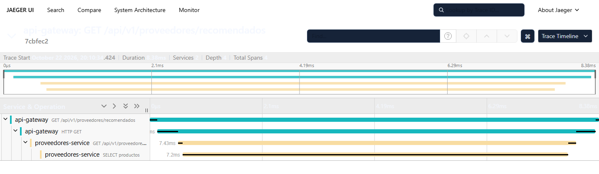

# Observabilidad: logs correlacionados y traza distribuida

Qué está instrumentado, cómo se reproduce la traza del flujo principal en la demo
y qué se tiene que ver en cada paso.

## La traza del flujo principal

Una request por el gateway produce **una sola traza** con cuatro spans anidados:

| # | Servicio | Span | Qué representa |
|---|---|---|---|
| 1 | `api-gateway` | `GET /api/v1/proveedores/recomendados` | la request que entra al sistema; abre la traza si el cliente no mandó `traceparent` |
| 2 | `api-gateway` | `HTTP GET` | la llamada de salida a la réplica elegida; es la que viaja con el `traceparent` |
| 3 | `proveedores-service` | `GET /api/v1/proveedores/recomendados` | la request del lado del servicio, que **continúa** la traza del gateway |
| 4 | `proveedores-service` | `SELECT productos` | la consulta a PostgreSQL, con el SQL y la tabla |



La propagación es W3C Trace Context (`traceparent`), con `OTEL_EXPORTER_OTLP_ENDPOINT`
apuntando a Jaeger (`http://jaeger:4318`) en los dos servicios.

El `X-Request-ID` viaja en paralelo al `traceparent`: el gateway lo genera si no
viene, lo devuelve al cliente y se lo pasa al servicio. Es lo que le permite a
quien consume la capacidad encontrar su request sin tener acceso a Jaeger.

## Reproducirla (paso 5 de la demo)

```powershell
Copy-Item .env.example .env
docker compose up -d --build --remove-orphans
docker compose ps            # los cinco contenedores tienen que quedar healthy

curl.exe -i -H "X-API-Key: clave-de-desarrollo" `
  "http://localhost:8080/api/v1/proveedores/recomendados?producto=PAN-450W-MONO&cantidad=10&limite=3"
```

Si en esa máquina ya se había levantado una versión anterior del compose,
`--remove-orphans` saca el contenedor `sonda`, que ya no existe en el archivo;
su volumen se borra aparte con `docker volume rm arq-soft-proveedores_sonda`.

De la respuesta se anota el header `X-Request-Id`. Con él se buscan las dos
líneas de log, una de cada contenedor:

```powershell
docker compose logs api-gateway proveedores-service-1 proveedores-service-2 |
  Select-String "<X-Request-Id>"
```

Las dos líneas traen el mismo `request_id` **y el mismo `trace_id`**:

```json
{"time":"2026-10-22T23:10:34.432475461Z","level":"INFO","msg":"request","service":"api-gateway","request_id":"d3b0695233b964f3cd6f674e7240a76f","method":"GET","path":"/api/v1/proveedores/recomendados","status":200,"duration_ms":8.361,"trace_id":"7cbfec25356a963b92f2f2a0461274cb","span_id":"1585c5655c52e099"}
{"time":"2026-10-22T23:10:34.432018915Z","level":"INFO","msg":"request","service":"proveedores-service","request_id":"d3b0695233b964f3cd6f674e7240a76f","method":"GET","path":"/api/v1/proveedores/recomendados","status":200,"duration_ms":7.324,"trace_id":"7cbfec25356a963b92f2f2a0461274cb","span_id":"d95ff831fc1682de"}
```

(son las líneas reales de la captura de arriba, recortadas: el log trae además
`query`, `bytes` y `remote_addr`.)

Ese `trace_id` es el que se pega en la UI de Jaeger, en
<http://localhost:16686> → **Lookup by Trace ID**. También se puede ir por
**Search → Service: proveedores-service**: ahí aparecen solo las trazas de
requests reales (ver "Lo que no se traza").

## Qué se ve en cada caso

| Caso | Qué se ve |
|---|---|
| 200 | los cuatro spans; el de la consulta trae `db.system`, `db.statement`, `db.sql.table` y `db.rows_affected`. Con varias requests en paralelo puede aparecer un quinto, `postgres connect`: el pool abre conexiones a demanda y la que la abre carga con ese span |
| 404 `PRODUCTO_NO_ENCONTRADO` | los mismos cuatro spans; el de la consulta sale **sin error**, porque un SKU inexistente no es una falla de la base |
| 503 `NO_DISPONIBLE` (`docker compose stop postgres`) | en lugar del span de la consulta aparece `postgres connect` en rojo, con el motivo; el 503 y el `code` del contrato no cambian |
| sin colector OTLP | el servicio arranca y responde igual; en el log queda `trazas deshabilitadas: no hay OTEL_EXPORTER_OTLP_ENDPOINT` |

Dos detalles que confunden la primera vez:

- En un 404, el span **cliente** del gateway (`HTTP GET`) queda marcado como
  error: la convención de OpenTelemetry es que para el que llama un 4xx es un
  fallo. El span del servidor y el contrato siguen diciendo 404, que es lo
  correcto.
- Con la base caída el fallo aparece como `postgres connect` y **no** como una
  consulta: `pool.Query` falla al tomar la conexión, antes de llegar a ejecutar
  el SQL, así que no hay span de consulta que marcar.
- **Una request puede salir sin ningún span de base**, si le toca una conexión
  del pool que todavía parece viva y el fallo aparece recién al hablar con el
  servidor. Medido: la primera request después de `docker compose stop postgres`
  dio una traza de tres spans; las tres siguientes, de cuatro. Depende de qué
  conexión agarra del pool y de hace cuánto está ociosa, así que **en la demo
  conviene hacer dos o tres requests y mostrar una que traiga el
  `postgres connect` en rojo**.

## Lo que no se traza, a propósito

- **`/healthz` y `/readyz` del servicio.** El healthcheck del contenedor y el
  sondeo del gateway los golpean cada 5 s: trazarlos llenaría Jaeger de trazas de
  un solo span y taparían las que cuentan un flujo.
- **Las consultas sin traza en curso**, como las migraciones del arranque: el
  tracer de pgx solo abre span si el contexto ya trae uno. (El `Ping` de
  `/readyz` no entra acá: `pool.Ping` llega a `pgConn.Ping`, que no pasa por el
  tracer de consultas. No genera spans aunque tuviera traza.)
- **Los valores de los parámetros de las consultas.** El span lleva el SQL con
  sus `$1`, nunca los `Args`. Hoy el único parámetro es un SKU, que es inocuo,
  pero así no se filtra un dato sensible el día que haya otra consulta.

## Dónde está cada cosa

| Pieza | Archivo |
|---|---|
| Logger JSON con `trace_id` y `span_id` | [`pkg/observabilidad/logger.go`](../../pkg/observabilidad/logger.go) |
| Inicialización de OpenTelemetry y propagador W3C | [`pkg/observabilidad/trazas.go`](../../pkg/observabilidad/trazas.go) |
| Span de entrada y de salida del gateway | [`services/api-gateway/internal/gateway/middleware.go`](../../services/api-gateway/internal/gateway/middleware.go), [`proxy.go`](../../services/api-gateway/internal/gateway/proxy.go) |
| Span de entrada del servicio (`otelhttp`) | [`services/proveedores-service/cmd/server/main.go`](../../services/proveedores-service/cmd/server/main.go) |
| Span de la consulta y de la conexión a Postgres | [`services/proveedores-service/internal/adapters/postgres/tracer.go`](../../services/proveedores-service/internal/adapters/postgres/tracer.go) |

## Rehacer la captura

La imagen de arriba se saca con Chrome en modo headless, con el id de una traza
que ya esté en Jaeger:

```powershell
& "C:\Program Files\Google\Chrome\Application\chrome.exe" --headless=new --disable-gpu `
  --hide-scrollbars --run-all-compositor-stages-before-draw --window-size=1440,420 `
  --virtual-time-budget=12000 --screenshot="docs\observabilidad\traza-entrega-2.png" `
  "http://localhost:16686/trace/<trace_id>"
```

Jaeger guarda las trazas en memoria: `docker compose restart jaeger` las borra
todas y deja la lista limpia para sacar la captura con una sola traza.
