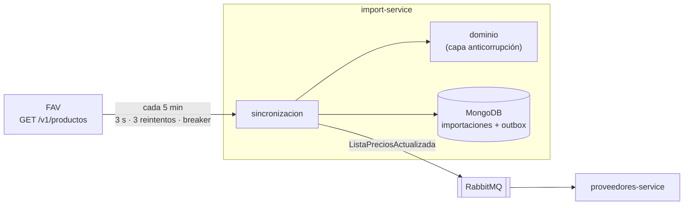

# import-service

Importa el catálogo de **FAV** (el grupo de ropa, nuestro proveedor externo), lo
traduce a ofertas de nuestro comparador y avisa los cambios con el evento
`ListaPreciosActualizada` por RabbitMQ. Decisiones: [ADR-009](../../docs/adr/ADR-009-consumo-proveedor.md)
(consumo de FAV), [ADR-005](../../docs/adr/ADR-005-comunicacion.md) (evento),
[ADR-003](../../docs/adr/ADR-003-persistencia.md) (MongoDB) y
[ADR-010](../../docs/adr/ADR-010-resiliencia.md) (circuit breaker).



## Qué hace en cada vuelta

1. **Baja el catálogo** de FAV con su clave (`X-API-Key`) y un `X-Correlation-Id`
   igual al id de la importación, para cruzar logs con FAV.
2. **Lo traduce** (`internal/dominio`): un producto nuestro por variante, con SKU
   `FAV-<varianteId>`, categoría `ropa-<categoría>`, flete `FAV_FLETE` y stock 10.
   Una variante con datos que no sirven se descarta y queda registrada.
3. **Lo compara** con lo último que se avisó y arma el evento solo con los
   cambios (altas, modificaciones y bajas). La primera vez, o después de un
   vencimiento, manda el catálogo completo.
4. **Guarda la importación en MongoDB con el evento adentro** (outbox) y lo
   publica con confirmación del broker. Si RabbitMQ no está, el evento espera y se
   reintenta cada 15 s, en orden.

Si FAV no responde, se guarda el intento con su error y **sigue valiendo la
última importación**. Después de **3** vueltas fallidas seguidas se abre el
circuit breaker y se saltean las **3** vueltas siguientes sin llamar a FAV; la cuarta hace una llamada de prueba. Si pasan **24 h** sin una
sincronización buena, se publica un evento que retira todas las ofertas de FAV
del ranking (`motivo: catalogo_vencido`), una sola vez.

El formato del evento y lo que tiene que hacer el consumidor están en
[`docs/contracts/eventos.md`](../../docs/contracts/eventos.md).

## Estructura

| Paquete | Qué tiene |
|---|---|
| `cmd/server` | Arranque, configuración y los dos ciclos (sincronización y outbox). |
| `cmd/sonda` | Healthcheck del contenedor (pregunta por `/readyz`). |
| `cmd/fav-mock` | Mock de FAV para desarrollo y Game Day. |
| `internal/dominio` | Traducción del catálogo y comparación entre importaciones. Sin dependencias. |
| `internal/sincronizacion` | La vuelta completa y sus puertos (`Almacen`, `Publicador`, `FuenteCatalogo`). |
| `internal/fav` | Cliente HTTP de FAV y **test de contrato** contra su OpenAPI. |
| `internal/resiliencia` | Circuit breaker. |
| `internal/adapters/mongo` | Almacén en MongoDB. |
| `internal/adapters/http` | `/healthz`, `/readyz`, `/estado` y `POST /sincronizar`. |
| `internal/favmock` | El mock (lo usa `cmd/fav-mock` y lo valida el test de contrato). |
| `internal/integracion` | Tests contra RabbitMQ real. |

`dominio` y `sincronizacion` no importan MongoDB, RabbitMQ ni HTTP: los reciben
por interfaces. Por eso los tests de la vuelta completa corren en memoria.

## Configuración

| Variable | Para qué | Por defecto |
|---|---|---|
| `MONGO_URL` | Conexión a MongoDB | obligatoria |
| `MONGO_DB` | Base donde va la colección `importaciones` | `importaciones` |
| `RABBITMQ_URL` | Conexión a RabbitMQ | obligatoria |
| `FAV_URL` | Base de la API de FAV (en el compose, el mock si no se define) | obligatoria |
| `FAV_API_KEY` | Clave que nos dio FAV | obligatoria |
| `FAV_PROVEEDOR_ID` | Id de FAV en la tabla `proveedores` | `11` |
| `FAV_FLETE` | Flete fijo por oferta | `0` |
| `INTERVALO_SINCRONIZACION` | Cada cuánto se baja el catálogo (mínimo `10s`) | `5m` |
| `OTEL_EXPORTER_OTLP_ENDPOINT` | Colector de trazas; sin él, las trazas quedan en no-op | — |
| `PORT` | Puerto HTTP | `8080` |

## API interna

No pasa por el gateway ni se publica al host: se usa desde la red del compose.

| Ruta | Qué devuelve |
|---|---|
| `GET /healthz` | `200` si el proceso está vivo. |
| `GET /readyz` | `200` si MongoDB responde; `503` si no. RabbitMQ y FAV no cuentan: sin ellos el servicio sigue siendo útil. |
| `GET /estado` | Última sincronización buena y su antigüedad, si está vencido, ofertas vigentes, eventos pendientes, estado del breaker y si el broker está conectado. |
| `POST /sincronizar` | Corre una vuelta en el momento y devuelve el resumen. |

Para verla durante la demo, desde otro contenedor de la red:

```bash
docker run --rm --network arq-soft-proveedores_interna curlimages/curl -s http://import-service:8080/estado
docker run --rm --network arq-soft-proveedores_interna curlimages/curl -s -X POST http://import-service:8080/sincronizar
```

## Mock de FAV

`cmd/fav-mock` sirve `GET /v1/productos` con 5 productos y 10 variantes, y
también los pedidos que le hace `stock-service`: `POST /v1/pedidos` (con
`Idempotency-Key`, todo o nada, hasta 10 unidades por variante) y
`GET /v1/pedidos/{pedidoId}`. A diferencia del mock que publica FAV, guarda el
estado de cada pedido y manda el webhook firmado a su `notificacionUrl`. Exige
la misma clave que `FAV_API_KEY` y firma con `FAV_MOCK_SECRETO_AVISOS` (en el
compose, el mismo `FAV_SECRETO_AVISOS` que verifica `stock-service`). Cumple el
contrato v1.1.0 de FAV: lo comprueban los tests de contrato. Rutas de control
(no son parte del contrato de FAV):

| Ruta | Para qué |
|---|---|
| `POST /_mock/modo` `{"modo": "..."}` | `normal`, `caido` (503), `lento` (5 s, más que el timeout), `limite` (429), `error` (500), `invalido` (200 fuera de contrato) |
| `POST /_mock/precio` `{"varianteId": "...", "precio": 1}` | Cambia un precio, para ver el cambio llegar en el evento siguiente |
| `POST /_mock/pedidos/{pedidoId}/estado` `{"estado": "PAGADO"}` | Simula que FAV verificó el pago (`PAGADO`), que venció (`VENCIDO`) o que el pago llegó tarde (`A_VERIFICAR`), y manda el aviso. `"duplicar": true` lo manda dos veces; `"firmaInvalida": true` lo firma con otro secreto |
| `POST /_mock/stock` `{"varianteId": "...", "stock": 0}` | Fija el stock de una variante, para forzar un `409 STOCK_INSUFICIENTE` |
| `GET /_mock/estado` | Modo actual, cuántas veces le pidieron el catálogo, cuántos pedidos tiene y los últimos avisos enviados con su respuesta |

En el compose se publica en `localhost:8090`.

## Tests

```bash
go test ./... -cover                                         # unitarios y de contrato
go test -tags=integration ./internal/adapters/mongo/ -v      # MongoDB real (Docker)
go test -tags=integration ./internal/integracion/ -v         # RabbitMQ real (Docker)
```

- **Test de contrato de los pedidos del mock** (`internal/fav/contrato_pedidos_test.go`):
  cada respuesta de `POST /v1/pedidos` y `GET /v1/pedidos/{pedidoId}` (201, la
  misma respuesta ante la misma clave, 409 por clave reutilizada y por stock,
  400, 404 y 503) y cada webhook (cuerpo `EventoPedido`, formato y firma de
  `X-FAV-Firma`, `X-FAV-Evento-Id`) validan contra el contrato de FAV, y el
  vector de firma del contrato coincide.
- **Test de contrato** (`internal/fav/contrato_test.go`): valida contra la copia
  del OpenAPI de FAV que nuestro cliente entiende su ejemplo, que nuestra request
  cumple el contrato y que el mock responde según el contrato. Contra el FAV
  desplegado:

  ```bash
  FAV_URL_CONTRATO=https://... FAV_API_KEY=... go test ./internal/fav/ -run Contrato -v
  ```

- **Cobertura** (03/11): `dominio`, `resiliencia` y `adapters/http` 100 %;
  `fav` 86,7 %; `sincronizacion` 86,2 %. `pkg/mensajeria` tiene 31,6 % en los
  unitarios porque el publicador se prueba contra RabbitMQ real, en
  `internal/integracion`.
- **Integración:** los de RabbitMQ (5) se corrieron contra un broker real y pasan;
  los de MongoDB compilan pero todavía no se corrieron en una máquina con Docker.
